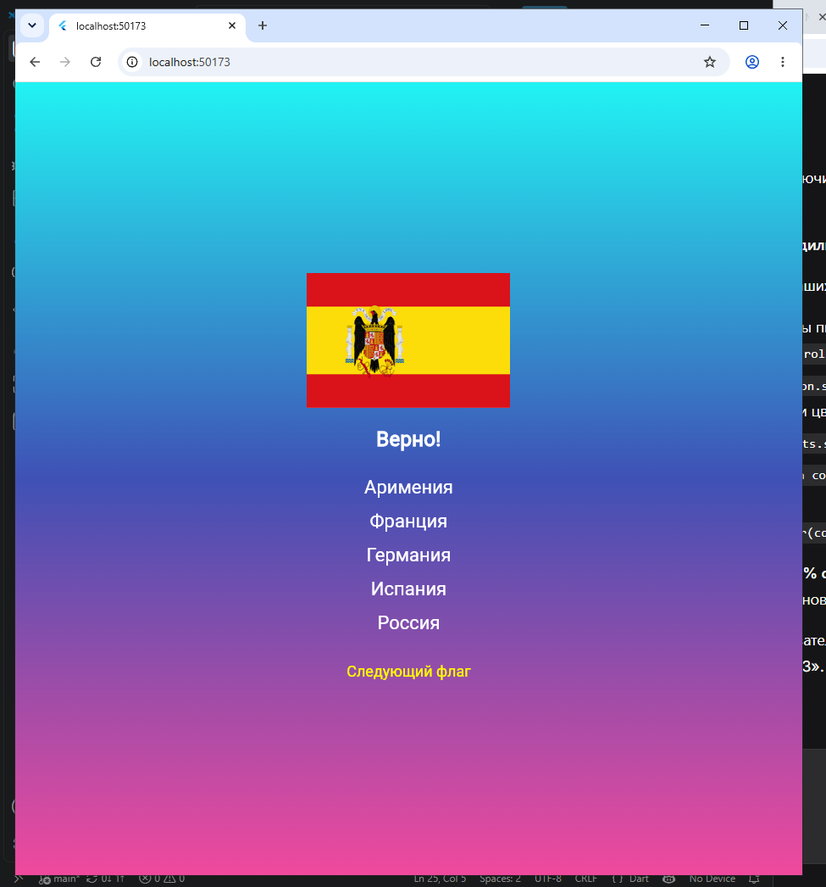

# Приложение «Угадай флаг»

Приложение-игра на тему «Угадай флаг». На экране показывается случайный флаг страны, а пользователю нужно выбрать правильное название из четырёх предложенных вариантов. При нажатии на кнопку «Следующий флаг» игра генерирует новый случайный флаг.

## Автор
- Аристова Анастасия
- Группа: ИСП-241
- Дата сдачи: 20.10.26

## Стек и версии
* Flutter: 3.47.3 
* Dart: 3.13.3
* Платформа: Web (Chrome)
* IDE: VS Code

## Скриншот приложения


## Структура проекта
* `lib/main.dart` — точка входа в приложение, настройка `MaterialApp` и отключение DEBUG-баннера
* `lib/gradient_container.dart` — кастомный виджет для отрисовки градиентного фона
* `lib/flag_card.dart` — кастомный виджет для отображения картинки флага и текста
* `lib/flag_screen.dart` — главный экран игры, содержит логику, состояние и кнопки

## Как запустить
```bash
git clone <ссылка на репозиторий>
cd <папка проекта>
flutter pub get
flutter run -d chrome
```
## Что изучили
1. Разбивка кода на файлы: Научилась создавать собственные виджеты-классы и выносить каждый в отдельный .dart файл, чтобы код не превращался в один огромный и запутанный main.dart

2. Управление состоянием: Закрепила на практике работу с StatefulWidget и использование setState(). Поняла как заставить интерфейс перерисоваться в ответ на действия пользователя (нажатие кнопок)

3. Передача данных через параметры: Освоила передачу информации (текста, путей к картинкам и цветов) внутрь виджетов через их конструкторы

4. Работа с ресурсами (Assets): Научилась подключать локальные изображения через pubspec.yaml и выводить их на экран с помощью виджета Image.asset
